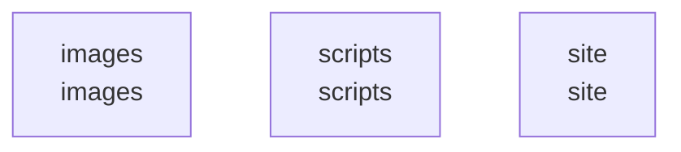

# overall-architecture

[解析トップへ戻る](../README.md)

# Awesome-AI-Agents

READMEを中心としたAI・OSSの資料集。実行アプリの構成図は適用せず、コンテンツ構成を記録します。

この図はリポジトリ内の構成です。コードを実行した結果やサービス間の通信保証ではありません。

## 対象と根拠

対象: https://github.com/FORIFOR/Awesome-AI-Agents

取得ブランチ: `main`

Git tree SHA: `7bc5e8134e5ed20ef60757f9502d7058f70821da`

ファイル一覧: 37件。内容確認: 3件。全ファイルの意味解析ではありません。

## 解析の制約

実コードの取得は入口、マニフェスト、直接参照先を中心とする初回解析です。動的ロード、実行時設定、別リポジトリとの接続、ローカル未コミット変更は未確認です。

## 確認が必要な点

構成図の配置関係と、実際の通信・呼び出し関係を区別してください。README上の機能や精度の記述は動作検証済みという意味ではありません。

## 追加解析

未読の中核モジュールから処理順序・データ保存・状態遷移を追加解析する。実行環境で通信先と機能フラグを照合する。

## 補足

2026-10-11の初回解析スナップショットです。現在のコードとの差分や実行環境は追加確認が必要です。

## 要素の説明

### n-images-19f49d

確認したパス: `images`。配下の登録ファイルは9件。

- `images/LLM-based-Agents.png`（一覧のみ）
- `images/agent-society.png`（一覧のみ）
- `images/autogen_agentchat.png`（一覧のみ）
- `images/awesome-ai-agents-icon.png`（一覧のみ）
- `images/awesome-ai-agents-icon.svg`（一覧のみ）
- `images/illustration.png`（一覧のみ）
- `images/multi-agent.png`（一覧のみ）
- `images/openagents_overview.png`（一覧のみ）
- `images/system_design.png`（一覧のみ）

### n-scripts-16728d

確認したパス: `scripts`。配下の登録ファイルは1件。

- `scripts/build-site.mjs`（内容確認済み）

### n-site-c099a4

確認したパス: `site`。配下の登録ファイルは20件。

- `site/.nojekyll`（一覧のみ）
- `site/app.js`（内容確認済み）
- `site/fonts/OFL.txt`（一覧のみ）
- `site/fonts/README.md`（一覧のみ）
- `site/fonts/bricolage-grotesque-latin-700.woff2`（一覧のみ）
- `site/icon.png`（一覧のみ）
- `site/icon.svg`（一覧のみ）
- `site/icons/README.md`（一覧のみ）
- `site/icons/activity.svg`（一覧のみ）
- `site/icons/chevron-down.svg`（一覧のみ）
- `site/icons/external-link.svg`（一覧のみ）
- `site/icons/github.svg`（一覧のみ）
- `site/icons/orbit.svg`（一覧のみ）
- `site/icons/search.svg`（一覧のみ）
- `site/icons/star.svg`（一覧のみ）
- `site/index.html`（一覧のみ）
- `site/resources.json`（一覧のみ）
- `site/robots.txt`（一覧のみ）
- `site/sitemap.xml`（一覧のみ）
- `site/styles.css`（一覧のみ）

[詳細な図と説明を見る](n-site-c099a4/README.md)

