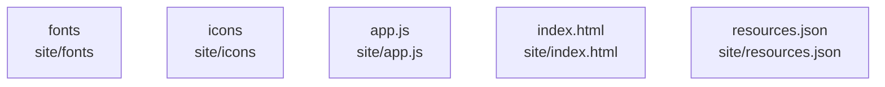

# overall-architecture/n-site-c099a4

[解析トップへ戻る](../../README.md)

確認したパス: `site`。配下の登録ファイルは20件。

- `site/.nojekyll`（一覧のみ）
- `site/app.js`（内容確認済み）
- `site/fonts/OFL.txt`（一覧のみ）
- `site/fonts/README.md`（一覧のみ）
- `site/fonts/bricolage-grotesque-latin-700.woff2`（一覧のみ）
- `site/icon.png`（一覧のみ）
- `site/icon.svg`（一覧のみ）
- `site/icons/README.md`（一覧のみ）
- `site/icons/activity.svg`（一覧のみ）
- `site/icons/chevron-down.svg`（一覧のみ）
- `site/icons/external-link.svg`（一覧のみ）
- `site/icons/github.svg`（一覧のみ）
- `site/icons/orbit.svg`（一覧のみ）
- `site/icons/search.svg`（一覧のみ）
- `site/icons/star.svg`（一覧のみ）
- `site/index.html`（一覧のみ）
- `site/resources.json`（一覧のみ）
- `site/robots.txt`（一覧のみ）
- `site/sitemap.xml`（一覧のみ）
- `site/styles.css`（一覧のみ）

## 要素の説明

### n-site-app-js-09f390

実在パス: `site/app.js`。1ファイル。

- `site/app.js`

### n-site-fonts-8263de

実在パス: `site/fonts`。3ファイル。

- `site/fonts/OFL.txt`
- `site/fonts/README.md`
- `site/fonts/bricolage-grotesque-latin-700.woff2`

### n-site-icons-34a47e

実在パス: `site/icons`。8ファイル。

- `site/icons/README.md`
- `site/icons/activity.svg`
- `site/icons/chevron-down.svg`
- `site/icons/external-link.svg`
- `site/icons/github.svg`
- `site/icons/orbit.svg`
- `site/icons/search.svg`
- `site/icons/star.svg`

### n-site-index-html-f8b5f3

実在パス: `site/index.html`。1ファイル。

- `site/index.html`

### n-site-resources-json-69ed5d

実在パス: `site/resources.json`。1ファイル。

- `site/resources.json`

